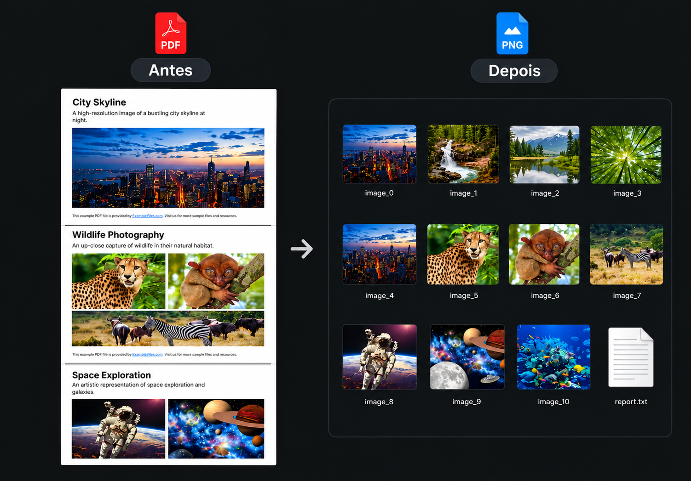
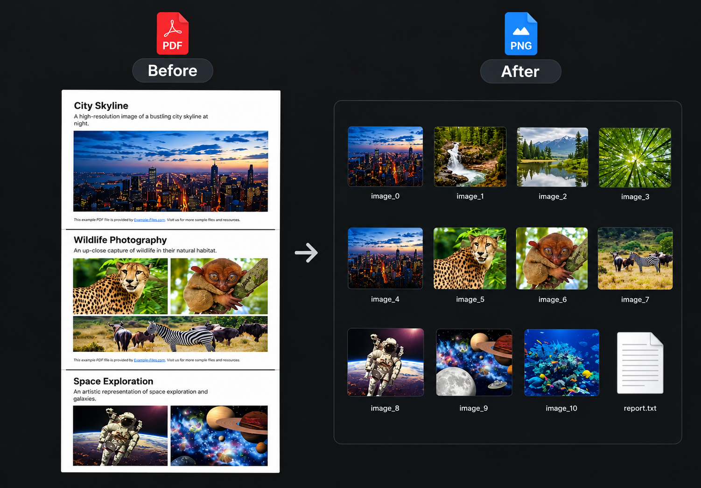

  <a href="#pt-br"> Português</a> &nbsp;|&nbsp; <a href="#en-us"> English</a>

---

##  Versão em Português

<h1 align="center">Extração de Imagens de PDF</h1>

  

##  Sobre o Projeto

Este projeto foi construído por mim para fins de freelancer e enriquecimento do meu portfólio. É um script em Python que extrai imagens de arquivos PDF colocados na pasta `input`, mantendo os formatos e dimensões originais de forma totalmente automatizada.

Ao final da execução, o sistema organiza os arquivos gerados na estrutura `images_{index}`, compacta tudo em um arquivo `.zip` e gera um relatório em texto com os detalhes de tudo o que foi extraído.

## Stack do Projeto

  
  
  
  

## Arquivos do Projeto

Você pode acessar o documento original e o resultado final da extração pelos links abaixo:

-  [Acessar o PDF original](./input/image-doc.pdf)
-  [Ver as imagens extraídas](./output/images.zip)

---

##  English Version

<h1 align="center">PDF Image Extraction</h1>

  

##  About the Project

This project was built by me for freelance purposes and to enrich my professional portfolio. It is a Python script that automatically extracts images from PDF files placed in the `input` folder, keeping their original formats and dimensions in a fully automated workflow.

After running, the system organizes all extracted assets using the `images_{index}` structure, compresses them into a single `.zip` file, and generates a text report with details of the processed files.

## Project Stack

  
  
  
  

## Project Files

You can access the original document and the final extraction results through the links below:

- [Access the original PDF](./input/image-doc.pdf)
- [View the extracted images](./output/images.zip)